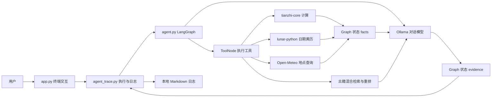
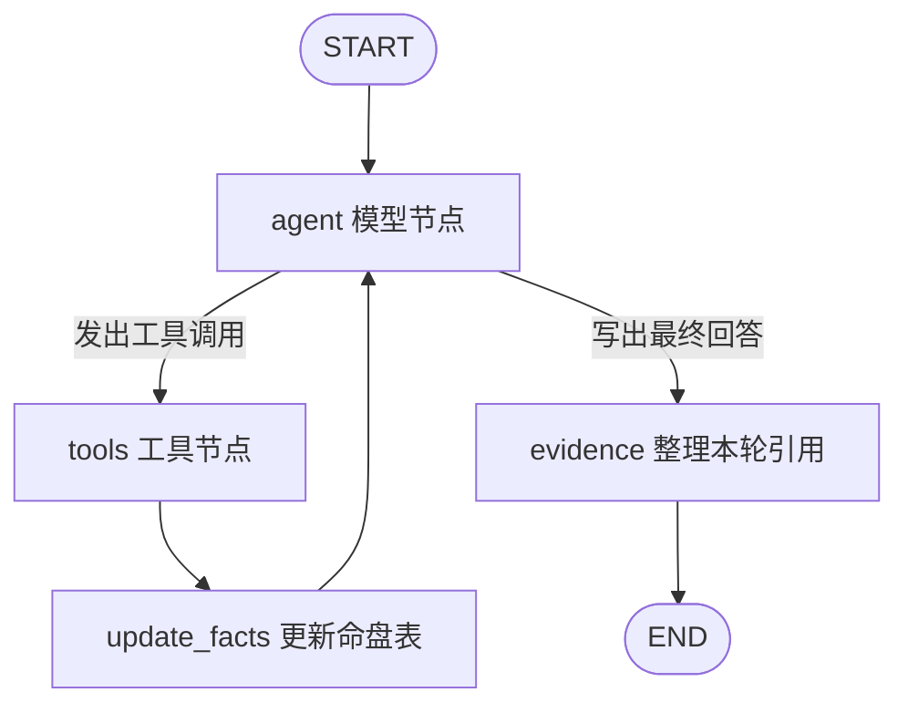
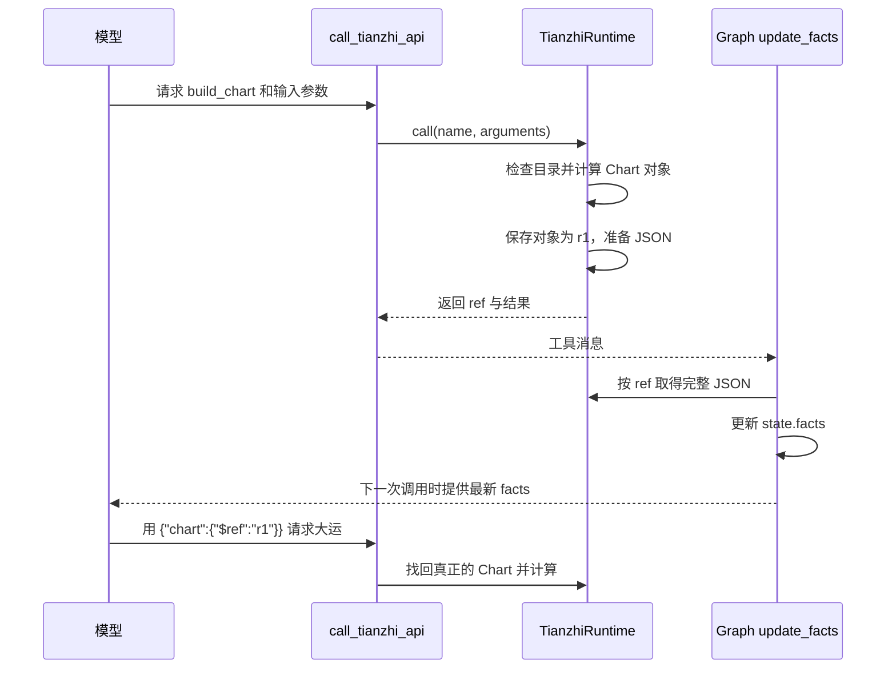

# 命理解读 Agent 项目介绍

本文介绍终端版命理解读 Agent（Chinese Metaphysics Interpretation Agent）的用途、项目文件、执行步骤与数据流，面向刚开始接触 Python 和 LangGraph 的读者。项目目前以八字为主要解读方向，将出生资料、历法和命盘计算、古籍检索、模型解读分开处理：计算工具返回结构化结果，语言模型选择工具并组织回答，Graph 协调执行顺序和本轮状态。

本项目是传统命理文化体验工具。计算符合某种口径或引用古籍，并不证明现实预测能力；工具结果也可能被模型误读。最终回答不是医疗、投资等专业建议。

## 1. 目前支持的功能

项目当前以八字排盘与命理解读为主，用户可以在终端提出问题、补充资料并继续追问。模型根据问题选择工具，结合工具结果和古籍材料组织回答。

| 功能 | 当前支持的内容 |
| --- | --- |
| 八字排盘与基础信息 | 根据出生资料和所选口径计算四柱，并查询日主、十神、藏干等命盘信息。默认按公历和真太阳时处理，用户可以指定其他口径。 |
| 旺衰、格局与用神 | 调用 `tianzhi-core` 的相关规则方法，获取日主旺衰、格局、用神及喜忌等结果和部分判断依据。 |
| 大运、流年与流月 | 排列大运，查询指定年份和月份的干支，并计算部分岁运与原局的关系。 |
| 日期与通用黄历 | 查询公农历、干支、节气、每日宜忌及冲煞。出生日期和待分析的目标日期分别保存；通用黄历宜忌不等同于个人命盘喜忌。 |
| 出生地点查询 | 根据城市和省级地区查询地点候选、经纬度和时区，供真太阳时计算参考。候选是地名代表点，不一定是精确出生地址。 |
| 古籍检索与引用 | 通过关键词和语义混合检索古籍，对候选重排，并返回原文、出处和片段 ID，供模型在解读中标注依据。 |
| 多轮追问与资料修改 | 在当前会话中复用消息、命盘表和计算对象引用；重新排盘后，程序替换当前命盘并清除旧盘计算结果。 |
| 执行日志与证据记录 | 记录用户输入、工具请求和返回、模型回答，以及本轮回答标注的古籍片段和未找到的引用 ID。 |

底层 `tianzhi-core` 还提供紫微斗数、奇门遁甲和大六壬等方法，Agent 可以查询并尝试调用；目前命盘表、古籍语料和测试主要围绕八字，其他术数仍属于探索性能力。引用 ID 能用于追溯片段，但项目尚不能自动保证引用适用或解读正确。

## 2. 项目的整体结构



图中只画主要关系。RAG 结果也作为工具消息进入 Graph 的 `messages`；`facts` 和 `evidence` 均属于当前图状态，不是单独的数据库。

## 3. 如何运行

需要本地 Python 环境、依赖和运行中的 Ollama 服务，以及一个支持工具调用的模型：

```bash
cd metaphysics_agent
source bazi/bin/activate
pip install -r requirements.txt
python app.py
```

`bazi/` 是本机虚拟环境，换一台机器时需要重新创建，不会随 Git 提交。可用环境变量指定模型和服务地址，例如：

```bash
OLLAMA_MODEL=qwen3.5:9b python app.py
```

`OLLAMA_BASE_URL` 设置 Ollama 服务地址，`OLLAMA_NUM_CTX` 设置上下文容量。命令 `/reset` 新建会话，`/quit` 或 `/exit` 退出。环境变量和默认值以 `app.py` 当前代码为准。

地点查询需要联网。古籍向量模型和重排模型首次使用时需要已缓存模型或可下载模型；首次建立向量索引可能较慢。Open-Meteo 免费地点接口只适用于其规定的非商业用途，详见 README 中的服务条款。

## 4. 主要文件和目录

| 文件 | 作用 | 核心实现 |
| --- | --- | --- |
| `app.py` | 程序入口和终端对话。 | 读取配置，创建 Ollama 模型、Graph 和 `SessionTrace`，循环读取输入，处理退出和重置。 |
| `agent.py` | Agent 的提示词和流程图。 | 定义 `AgentState`，绑定工具，连接 `agent`、`tools`、`update_facts`、`evidence` 节点。 |
| `agent_trace.py` | 驱动一轮 Graph，记录日志。 | 用 `graph.stream(..., stream_mode="values")` 观察状态；保存新消息、证据及中断原因；将 `facts` 传给下一轮。 |
| `tools/catalog.py` | 查询 `tianzhi-core` 可用方法。 | 按 layer、module、完整方法名分层返回目录和说明。 |
| `tools/module_descriptions.json` | 各模块的简短用途说明。 | 作为分层目录展示的本地说明表；库升级后需要核对。 |
| `tools/tianzhi_runtime.py` | 执行 `tianzhi-core` 方法。 | 检查公开目录、解析 `$ref`、转换参数、执行计算、保存 Python 对象并生成 JSON。 |
| `tools/date_info.py` | 查询日期信息和通用黄历。 | 封装 `lunar-python` 的公农历、干支、节气、每日宜忌和冲煞。 |
| `tools/location.py` | 查询地点候选。 | 请求 Open-Meteo，返回地名、WGS84 坐标、时区等；不自动确定哪个候选是出生地。 |
| `tools/session_state.py` | 命盘事实表的数据结构和更新方法。 | `SessionFacts` 复制当前字典，提供命盘、计算结果、日期和地点的更新方法；Graph 节点使用它生成新状态。 |
| `tools/rag.py` | 检索和重排古籍。 | 加载 JSONL，切分片段，分别用 BM25、向量检索召回，经 RRF 融合和交叉编码器重排。 |
| `tools/evidence.py` | 整理每轮引用证据。 | 从最终回答提取 `【passage_id】`，回查工具消息，保留所引用的片段和未找到的 ID。 |
| `tools/__init__.py` | 标识 Python 工具包。 | 使 `tools` 下的模块便于导入。 |
| `requirements.txt` | Python 依赖清单。 | 指明 LangGraph、LangChain Ollama、`tianzhi-core`、`lunar-python`、PyTorch 等依赖。 |
| `classics/` | 古籍语料与许可说明。 | JSONL 每行记录一段章节数据；`LICENSES.md` 记录来源许可信息。 |
| `tool_workflow_test/` | 排盘与 RAG 的实验文件。 | Notebook 展示实验流程；HTML 是 Notebook 的导出件，监控脚本用于实验。 |
| `.agent_trace/` | 每次会话的执行日志。 | Markdown 文件含用户输入、工具调用、结果、回复和每轮证据。 |
| `.rag_cache/` | 古籍向量缓存。 | 通过语料、模型和切分参数生成缓存标识；缓存可重建。 |

## 5. 从启动到用户获得回答

### 5.1 `app.py` 初始化

1. 读取环境变量，确定 Ollama 模型、地址及上下文配置。
2. 创建 `ChatOllama` 模型。
3. `create_graph(model)` 创建一张会话使用的图，并为该图创建 `TianzhiRuntime` 等运行资源。
4. `SessionTrace(model_name)` 创建本地日志；`messages = []` 初始化对话历史。
5. 进入循环，等待用户输入。

输入 `/reset` 时重新创建 Graph、日志和历史，原来的运行时对象引用不再适用。

### 5.2 `SessionTrace.run_turn()` 交给图执行

每轮用户输入会被包装为 `HumanMessage`，追加到历史。`SessionTrace` 把消息以及上一轮保存的 `facts` 交给图：

```text
{ "messages": 历史消息 + 本轮用户消息,
  "facts": 上一轮命盘表 }
```

然后通过 `graph.stream(..., stream_mode="values")` 逐步读取图状态。`values` 返回的是当前状态，不仅仅是新增消息；`seen` 用来避免旧消息重复写日志。图运行完成后，最后的消息列表返回给 `app.py`，终端显示最后一条模型回复。

### 5.3 Graph 的节点和顺序



- `agent`：把系统提示词、当前 `facts` 和消息历史交给模型。模型返回工具调用或文字。
- `tools`：`ToolNode` 按模型请求运行工具，产生 `ToolMessage`。独立工具可能并发运行。
- `update_facts`：读取刚产生的工具回执，更新 Graph 的 `facts`。失败结果不会替换先前成功的事实。
- `evidence`：从最终回答中的引用 ID 找回对应古籍片段，将本轮记录写入 Graph 的 `evidence`。

`tools_condition` 根据模型消息决定继续调用工具，还是进入证据节点。一个问题可能在 `agent → tools → update_facts → agent` 之间循环多次。

## 6. Graph 状态：`messages`、`facts`、`evidence`

状态可简化理解为：

```python
{
    "messages": [...],   # 历史用户消息、模型消息和工具回执
    "facts": {...},      # 当前命盘、计算、日期和地点信息
    "evidence": {...}    # 本轮最终回答的引用记录
}
```

它们的内容和寿命不同：

| 字段 | 用途 | 如何更新 |
| --- | --- | --- |
| `messages` | 给模型保留会话和工具回执 | 用户输入时追加用户消息，节点追加模型消息和工具消息。 |
| `facts` | 快速读取本会话当前命盘相关数据 | 工具回执由 `update_facts` 按类型归并；终端通过 `SessionTrace` 在下一轮传回。 |
| `evidence` | 当前这一轮的证据快照 | 模型完成回答后由 `evidence` 节点生成；执行日志记录该轮内容。 |

状态在一次 Graph 运行中由各节点传递。这个终端程序没有配置 LangGraph 持久化检查点；跨轮的消息和 `facts` 由 `app.py` / `SessionTrace` 在进程内传递。如果直接用 `graph.invoke()` 自己写调用代码，下一轮需要显式传回上一次的 `messages` 和 `facts`。重启程序不会自动恢复这些内存状态。

### 6.1 命盘表的结构和覆盖规则

```python
{
    "chart": None,                 # 当前命盘 JSON
    "chart_inputs": None,          # 本次排盘的参数
    "calculation_results": {},     # 按 tianzhi-core 完整方法名保存
    "date_info": None,             # 最近一次目标日期查询
    "birth_date_info": None,       # 最近一次出生日期或农历转换
    "location_search": None        # 查询状态或实际排盘经度对应的地点
}
```

`update_facts` 对不同工具使用不同栏目，避免不同 JSON 中的 `name`、`result` 等同名字段互相覆盖：

- 成功调用 `bazi.chart.build_chart`：替换 `chart` 和 `chart_inputs`，清空旧盘的 `calculation_results`。
- 成功调用其他 `bazi.*` 方法：以方法完整名称作为键记录参数和结果；同一方法再次调用会覆盖该方法的旧结果。
- `get_date_info`：必须提供用途 `purpose`；`target` 更新 `date_info`，`birth` 更新 `birth_date_info`，两者不会互相覆盖。
- `lookup_location`：按城市和省份查询，并过滤掉不属于该省的候选。候选仍在工具消息中；未排盘时命盘表只记录查询状态与数量，排盘后只记录能与实际经度匹配的一个地点，找不到或无法唯一匹配时标注未知，不把所有同名地点放进证据。已排盘后，单独搜索其他地方不会更改该命盘的地点。
- 查询失败：保留原有信息，错误仍在工具消息和日志中。

一次对话若需要比较同一方法对多个年份的结果，当前表只保留该方法最近一次结果；历史工具消息仍在 `messages` 中。`facts` 的值不自动证明模型最终文字正确。

### 6.2 `evidence` 的内容

每轮证据节点保存：本轮问题、当时的 `facts` 快照、最终回答、实际标注的古籍片段，以及找不到的引用 ID。模型引用上轮材料时，也会从消息历史中查找，并标记是否为本轮召回。

只有模型按 `【passage_id】` 格式标在回答中的材料才作为引用记录。程序能检查 ID 是否来自检索回执，不能仅凭 ID 判断原文是否支持解读，也不会自动重写或拦截错误回答。高级模型语义审查尚未接入。

## 7. 排盘工具和 `runtime` 如何配合

`TianzhiRuntime` 是 `call_tianzhi_api` 的执行器，而不是模型。它先检查方法是否在 `tianzhi-core` 公开目录中，再处理参数，执行对应方法并返回 JSON。



`runtime` 保存真实 Python 对象，是因为 `tianzhi-core` 某些方法需要 `Chart` 或 `Quad`，而不仅是 JSON。`facts` 保存便于模型阅读和记录的 JSON；两者不是同一份东西。Graph 用临时结果记录读取完整计算数据，避免大型结果的工具回执预览被截断后丢失事实。

重新排盘后，旧的对象引用会失效。当前运行时对象保存在 Graph 实例内部的内存中，不能在重启后自动恢复，也不适合把同一个 Graph 实例当成多个用户共享的会话。

## 8. 日期和地点信息怎么进入状态

例如用户问某日运势时，模型可以先请求 `get_date_info` 并指定 `purpose="target"`。工具返回 JSON 后，`update_facts` 把它写入 `facts.date_info`；出生日期转换用 `purpose="birth"`，单独写入 `facts.birth_date_info`。日期工具默认按公历、未给时间时按当地钟表零时查询，不自行做时区或真太阳时转换。

出生地查询类似：`lookup_location` 必须提供城市和省份，候选保存在工具消息中。模型应核对城市、地区和用户提供的信息；排盘后将经度能唯一匹配到的地点写入 `facts.location_search`，地名代表点不是精确出生地址。默认公历及真太阳时写在系统提示词中，但具体口径仍要由工具参数和结果记录。

黄历中的每日宜忌是通用日期信息；命盘的个人喜忌需要结合排盘和规则工具，不能将两者直接等同。

## 9. 古籍 RAG 怎样检索

```text
古籍 JSONL
   ↓ 切分为带 passage_id 的片段
   ├─ BM25：查关键词
   └─ 向量：查语义相似内容
          ↓
       RRF 融合两路排名
          ↓
       交叉编码器对候选重排
          ↓
       返回原文、出处、ID 和分数
          ↓
       模型判断如何使用并标注 ID
```

`tools/rag.py` 使用 jieba 和命理术语进行关键词分词；向量检索将较长片段拆成短窗口，窗口命中后映射回父片段。RRF 根据两路名次融合，不直接把 BM25 分数和向量相似度相加；交叉编码器再对最多 30 条候选评分排序。`limit` 决定最终返回数量。

RAG 分数是排序信号，不是正确率。召回文本可能只是关键词相似，未必适用于当前命盘；模型也可能错误引用，需结合证据链评测。

## 10. 日志、异常和隐私

每个 `SessionTrace` 创建一个 `.agent_trace/session-...md`。每轮写入用户输入、可见的模型思考字段、工具调用、工具返回、最终回复和本轮证据；具体是否有思考字段取决于模型接口。异常或用户中断时会追加中断原因。

日志可能包含出生资料、命盘及模型输出，应像个人资料一样管理。`.gitignore` 默认排除日志和缓存。日志是供查看的记录，不是会话恢复数据库。工具可能在中断前已完成部分操作；Graph 状态和内存对象不是持久化事务。

## 11. 测试与当前边界

```bash
python -m unittest discover -s tests -v
```

测试使用部分替身模型和工具，使流程可重复；它们不能代替真实 Ollama 端到端试验，也不能证明命理解释或检索结果正确。网络服务可用性、不同地区的历史时区、交节与晚子时口径都需要相应场景的进一步验证。

当前尚未实现：多用户隔离与持久化恢复、自动验证每条引用是否支持结论、使用高级模型评审或微调。证据链提供后续审查所需的本轮事实和实际标注片段，但它本身不是正确性证明。
