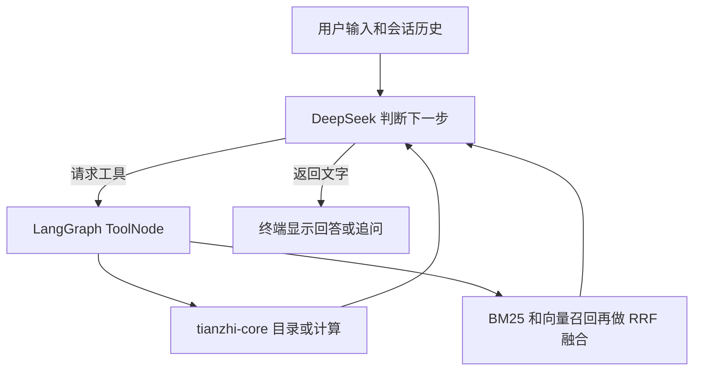

# 终端八字 Agent

Agent 根据用户问题选择工具。LangGraph 将工具结果交回模型，模型可以继续检索、计算、追问或回答。同一对话中的历史消息和计算结果引用保存在进程内。

## 运行

进入项目目录，激活项目环境并启动 Ollama。模型需要支持原生工具调用。终端默认使用 `deepseek-r1:8b`，由 `app.py` 读取。Notebook 内的模型配置用于各自的实验。

```bash
cd bazi_agent
source bazi/bin/activate
pip install -r requirements.txt
python app.py
```

`OLLAMA_MODEL` 的值优先于终端默认值。可以用 `OLLAMA_MODEL=deepseek-r1:8b python app.py` 为这一次运行指定模型。`OLLAMA_BASE_URL` 设置连接地址，`OLLAMA_NUM_CTX` 设置上下文长度。输入 `/reset` 开启新会话，输入 `/quit` 退出。

## 执行流程



模型通过原生工具调用自行选择下一步，工具执行结果会回到模型，由模型继续计算、检索或回答。

每个会话在 `.agent_trace/` 下有一份 Markdown 执行日志。按轮次查看用户输入、模型发出的工具请求、实际返回给模型的工具数据和最终回复。工具请求的 `id` 对应返回的 `tool_call_id`。如果本轮中断，日志会记下错误。`/reset` 会开启另一份日志。文件包含输入的出生资料和命盘，请按本地记录保管。

模型返回独立的 thinking 内容时，日志会以“模型思考”记录。`qwen3:4b-instruct` 使用 Instruct-2507 非思考版本，不会产生独立 thinking；使用支持 thinking 的版本时才会出现相应记录。

## 工具

- `inspect_tianzhi_api` 查询安装版 `tianzhi-core` 的公开目录、签名和返回字段。用 `layer="bazi"` 查看八字层，可按模块或完整方法名筛选。
- `call_tianzhi_api` 按目录执行计算。比如用 `bazi.chart.build_chart` 生成四柱、藏干、十神，再用返回的 `{"$ref":"r1"}` 或 `{"$ref":"r1.quad"}` 调用大运、流年、旺衰、用神等方法。
- `search_classics` 接收 Agent 直接填写的 `keyword_queries` 和 `semantic_queries`。用 BM25 和向量分别召回，再按片段 ID 进行 RRF 融合，返回古籍文本、出处、片段 ID 和各路排名。

古籍索引使用 `classics/`，沿用 `tool_workflow_test/rag_test.ipynb` 的切分、分词和向量窗口设置。首次使用向量检索时加载 embedding 模型。语料和模型版本一致时可以复用 Notebook 在 `.rag_cache/` 生成的向量。

## 文件分工

| 文件或目录 | 职责 |
| --- | --- |
| `app.py` | 读取 Ollama 配置，运行终端会话，处理 `/reset` 和 `/quit`。 |
| `agent.py` | 定义系统提示词，绑定三个工具，搭建模型与工具之间的循环。 |
| `agent_trace.py` | 观察图执行期间新增的消息，按轮次写入本地日志。 |
| `tools/catalog.py` | 读取安装版 `tianzhi-core` 的方法目录和签名。 |
| `tools/tianzhi_runtime.py` | 执行目录里的方法，保留原始计算对象，分配可串联的 `$ref`。 |
| `tools/rag.py` | 加载并切分古籍，为 BM25 和向量检索建立索引，融合并返回出处。 |
| `tools/validation.py` | 独立的旧输入辅助函数。当前图只有模型和工具节点。 |
| `tools/__init__.py`、`requirements.txt` | 工具包说明和 Python 依赖清单。 |
| `classics/`、`.rag_cache/` | 古籍 JSONL 语料与可复用的文档向量。 |
| `knowledge/` | 早期示例资料。当前古籍检索读取 `classics/`。 |
| `tool_workflow_test/` | `tianzhi_test.ipynb` 试验排盘 API，`rag_test.ipynb` 试验检索，`rag_test.html` 是 Notebook 导出件，`ollama_stream_monitor.py` 是 Ollama 流式进度的实验辅助代码。 |
| `tests/` | 测试工具路由、结果引用、查询格式和执行日志。 |

```bash
python -m unittest discover -s tests -v
```
