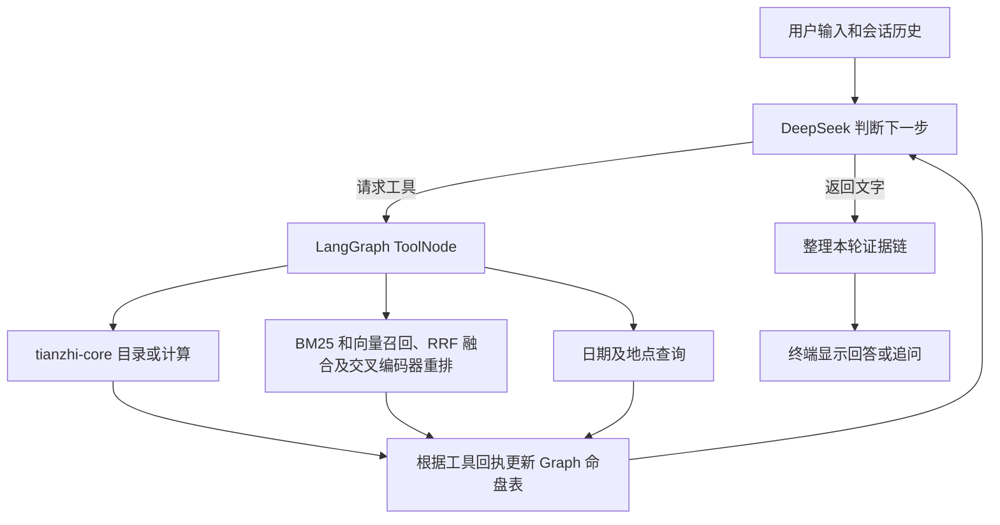

# 命理解读 Agent（Chinese Metaphysics Interpretation Agent）

Agent 根据用户问题选择工具。LangGraph 将工具结果交回模型，模型可以继续检索、计算、追问或回答。同一对话中的历史消息、计算结果引用和命盘信息表保存在进程内；重启或 `/reset` 后清空。

项目结构、Graph 节点和数据流的详细介绍见 [项目介绍](PROJECT_GUIDE.md)。

## 运行

进入项目目录，激活项目环境并启动 Ollama。模型需要支持原生工具调用。终端默认使用 `qwen3.5:9b`，由 `app.py` 读取。Notebook 内的模型配置用于各自的实验。

```bash
cd metaphysics_agent
source bazi/bin/activate
pip install -r requirements.txt
python app.py
```

`OLLAMA_MODEL` 的值优先于终端默认值。可以用 `OLLAMA_MODEL=deepseek-r1:8b python app.py` 为这一次运行指定模型。`OLLAMA_BASE_URL` 设置连接地址，`OLLAMA_NUM_CTX` 设置上下文长度。输入 `/reset` 开启新会话，输入 `/quit` 退出。

## 执行流程



模型通过原生工具调用自行选择下一步，工具执行结果会回到模型，由模型继续计算、检索或回答。

每个会话在 `.agent_trace/` 下有一份 Markdown 执行日志。按轮次查看用户输入、模型发出的工具请求、实际返回给模型的工具数据和最终回复。工具请求的 `id` 对应返回的 `tool_call_id`。如果本轮中断，日志会记下错误。`/reset` 会开启另一份日志。文件包含输入的出生资料和命盘，请按本地记录保管。

模型写完回复后，证据节点读取其中 `【passage_id】` 格式的引用，从本会话的检索回执中找回实际片段；每轮记录问题、回复、当时的命盘信息表、引用片段和未找到的引用 ID。记录会追加到执行日志的“本轮证据链”。未被标注的资料不会记录为引用；引用 ID 存在也不代表原文支持结论。若复用上一轮材料，会标记其不是本轮召回。

模型返回独立的 thinking 内容时，日志会以“模型思考”记录。`qwen3:4b-instruct` 使用 Instruct-2507 非思考版本，不会产生独立 thinking；使用支持 thinking 的版本时才会出现相应记录。

## 工具

- `inspect_tianzhi_api` 分层查询安装版 `tianzhi-core` 目录：只传 `layer` 返回模块及用途；传 `layer` 和 `module` 返回该模块的方法完整说明；传 `name` 查看单个方法。模块说明维护在 `tools/module_descriptions.json`。
- `call_tianzhi_api` 按目录执行计算。比如用 `bazi.chart.build_chart` 生成四柱、藏干、十神，再用返回的 `{"$ref":"r1"}` 或 `{"$ref":"r1.quad"}` 调用大运、流年、旺衰、用神等方法。
- `get_date_info` 使用 `lunar-python` 查询公农历日期、干支、节气、每日通用黄历宜忌及冲煞；必须指定用途 `purpose="birth"`（出生日期）或 `purpose="target"`（目标日期），分别写入 `birth_date_info` 和 `date_info`。农历闰月须显式指定。支持当地钟表时间，缺省为零时，结果不做时区或真太阳时修正。黄历宜忌不等于个人命盘的喜忌。
- `lookup_location` 使用 Open-Meteo 地理编码查询地点候选、WGS84 经纬度和时区。必须分别输入城市或区县和省级地区，例如 `name="佛山", province="广东"`；只返回省级地区匹配的候选。结果是地名代表点而非出生地址；多个候选时须核对。命盘表不保存完整候选列表，只在排盘后记录能与实际经度匹配的地点，无法匹配时标明未知；候选仍保存在工具回执日志。免费接口无需密钥，仅限非商业用途；数据来自 Open-Meteo / GeoNames，参见 [服务文档](https://open-meteo.com/en/docs/geocoding-api)和[使用条款](https://open-meteo.com/en/terms)。地点查询需要联网；失败时可让用户提供经度。
- `search_classics` 接收 Agent 填写的 `question`、`keyword_queries` 和 `semantic_queries`。用 BM25 和向量分别召回，按片段 ID 进行 RRF 融合，再用交叉编码器对最多 30 条候选重排，返回古籍文本、出处、片段 ID、各路排名和重排分数。

古籍索引使用 `classics/`，沿用 `tool_workflow_test/rag_test.ipynb` 的切分、分词、向量窗口和重排设置。首次检索时加载 embedding 模型和独立的交叉编码器；本机没有模型缓存时需要联网下载。语料和模型版本一致时可以复用 Notebook 在 `.rag_cache/` 生成的向量。重排分数是排序信号，不是正确率；输入截断时会在 `notices` 中提示。

用户未指定历法时提示词默认公历，默认真太阳时；模型应展示口径并根据地点查询经度，用户指定其他口径时以用户要求为准。`tianzhi-core` 当前将带时区时间转换为东八区后计算，海外及历史时区情况需要进一步验证。

命盘信息表 `facts` 是 Graph 状态的一部分。工具成功返回后，`update_facts` 节点更新命盘、八字计算结果、最近一次日期和地点候选；每次模型调用前读取当前状态。终端会话通过 `SessionTrace` 将事实表传到下一轮。重新排盘会清除旧计算结果和旧对象引用；不同方法各保留最近一次结果。表格不是持久化数据库，也不自动校验模型的回答。日期和地点查询失败不会覆盖之前成功的结果。

## 文件分工

| 文件或目录 | 职责 |
| --- | --- |
| `app.py` | 读取 Ollama 配置，运行终端会话，处理 `/reset` 和 `/quit`。 |
| `agent.py` | 定义系统提示词，绑定工具、注入会话事实表，搭建模型与工具之间的循环。 |
| `agent_trace.py` | 观察图执行期间新增的消息，按轮次写入本地日志。 |
| `tools/catalog.py` | 读取安装版 `tianzhi-core` 的方法目录和签名。 |
| `tools/tianzhi_runtime.py` | 执行目录里的方法，保留原始计算对象，分配可串联的 `$ref`。 |
| `tools/date_info.py`、`tools/location.py` | 查询日期、黄历及地点候选。 |
| `tools/session_state.py` | 定义并更新 Graph 中的命盘事实表。 |
| `tools/evidence.py` | 从最终回复的引用 ID 查找真实检索片段，记录每轮证据。 |
| `tools/module_descriptions.json` | tianzhi-core 各模块的简要说明。 |
| `tools/rag.py` | 加载并切分古籍，进行 BM25、向量检索、融合与重排，返回出处。 |
| `tools/__init__.py`、`requirements.txt` | 工具包说明和 Python 依赖清单。 |
| `classics/`、`.rag_cache/` | 古籍 JSONL 语料与可复用的文档向量。 |
| `knowledge/` | 早期示例资料。当前古籍检索读取 `classics/`。 |
| `tool_workflow_test/` | `tianzhi_test.ipynb` 试验排盘 API，`rag_test.ipynb` 试验检索，`rag_test.html` 是 Notebook 导出件，`ollama_stream_monitor.py` 是 Ollama 流式进度的实验辅助代码。 |
| `tests/` | 测试工具路由、结果引用、查询格式和执行日志。 |

```bash
python -m unittest discover -s tests -v
```
